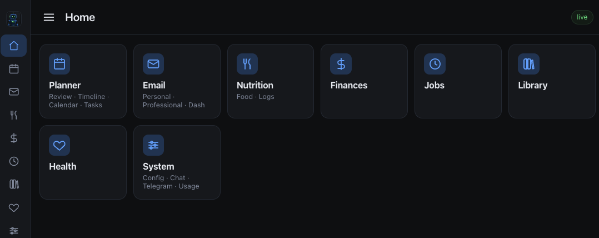
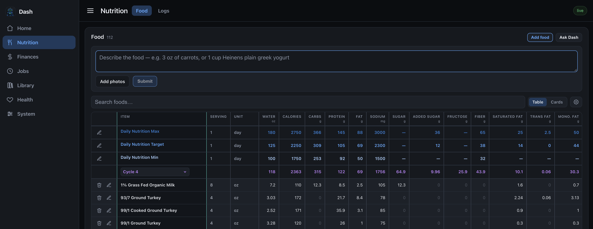

# Dash

**A self-hosted personal AI assistant running on a Mac mini.**

Dash is an always-on assistant that I built and run at home. It pairs an LLM agent with a set of tool integrations: files, banking, scheduled jobs, a headless browser, a printer and more. You can reach it from a web dashboard, from Telegram, or by voice ("Hey Dash").



---

## Highlights

- **One agent, several interfaces.** The web app, Telegram, room microphones and an iPhone or MacBook voice client all share the same agent and the same tools.
- **Tool-using LLM agent.** Dash has about 30 tools across 7 plugin-style providers. The agent chooses which tools to call to finish a request.
- **Human-in-the-loop edits.** When the AI proposes changes to nutrition data or files, it shows them as a reviewable diff. Nothing is written until I approve it.
- **Self-hosted and private.** Dash runs on my own hardware under pm2, and the dashboard is only reachable over my Tailscale network. My personal data never goes to a third-party host.
- **Installable PWA.** The dashboard can be installed on a phone and supports push notifications.

---

## AI Integrations

AI is built into every layer of Dash, not added as a single chat box.

| Integration | How it's used |
|---|---|
| **Agentic LLM core** | Every request runs through an LLM agent (OpenAI Codex) that plans its steps and calls Dash's tools to complete multi-step tasks. Recent conversation is replayed to keep context between turns. |
| **Vision: nutrition from photos** | Upload a photo of a nutrition label or a meal, and the model pulls out a full nutrient profile for review before it is saved. |
| **AI-assisted data editing** | "Ask Dash" works on the Nutrition, Meal Log and Library pages. It answers questions about the data on screen or proposes changes, shown as a diff that I approve before anything is written. |
| **Meal planning against targets** | The agent balances daily food logs against nutrient minimums, maximums and goals, and suggests changes. |
| **Autonomous scheduled agents** | Jobs are plain-language prompts that the agent runs on a schedule with no one present, for example morning briefings and recurring reports. |
| **Sub-agent delegation** | Heavy research tasks are handed to a fresh agent session so the main conversation stays focused. |
| **Speech to text** | **Whisper** transcribes voice commands on the machine itself. |
| **Custom wake word** | An always-listening **"Hey Dash"** wake word, using a custom **Picovoice Porcupine** model, that runs entirely on the machine. I first trained my own detector (synthetic speech samples, a small neural network exported to ONNX; see `voice/train_hey_dash.py`), then switched to Porcupine because it detected the wake word more reliably. |
| **Voice-optimized replies** | A second, lightweight LLM pass rewrites the agent's answer into short, natural speech before it is spoken aloud. |
| **AI developer tooling** | A read-only **MCP server** gives AI coding agents access to service health, logs and error scans while they work on the codebase. |

---

## The Web Dashboard

The dashboard is a dark-themed, mobile-friendly single-page app served directly by Dash. Each card on the home screen opens one area:

| Page | What it does |
|---|---|
| **Nutrition** | A food database with full nutrient profiles, reusable meal groups, and daily food logs tracked against nutrient targets. You can describe a food or **upload a photo of a label**, and Dash looks up the nutrition facts for you to review before saving. |
| **Finances** | Account balances and an income and expense summary from linked bank accounts, using **Plaid**. |
| **Jobs** | A scheduler for recurring prompts, for example "every weekday at 7am, summarize my calendar." You can create, edit, toggle and delete jobs inline, and run status streams live to the page. |
| **Library** | A file browser for my notes vault, with viewers for Markdown, JSON, PDFs and images, plus an in-place editor. **Ask Dash** answers questions about the open file or proposes edits to it. |
| **Health** | Lab results and vitals plotted over time, with reference-range bands that flag out-of-range values. |
| **System** | Live configuration editing and a one-click service restart. |


*The Nutrition page. Describe a food or add a photo, and Dash fills in the nutrients. Each food is tracked against daily minimum, target and maximum values.*

---

## Other Ways to Talk to Dash

- **Telegram:** a chat interface locked to a single user ID. It accepts photos and documents, for example "print this" or "save this image."
- **Voice:** each room has a microphone listening for a custom **"Hey Dash"** wake word (Picovoice Porcupine). Speech is transcribed with **Whisper**, and the reply is spoken back on the speaker in the same room.
- **Remote voice:** lightweight clients for iPhone and MacBook send requests to the same agent over the tailnet.

---

## Private Network: Reachable From Anywhere, Exposed Nowhere

Dash never touches the public internet. My Mac mini, MacBook Pro and iPhone are joined in a private **Tailscale** network (a WireGuard mesh VPN), so I can reach Dash from anywhere — home Wi-Fi, cellular, a coffee shop — without opening router ports or running a public server.

```
          ┌──────────── Tailscale private network (WireGuard) ────────────┐
          │                                                               │
   iPhone │  Safari / home-screen PWA  ─┐                                 │
          │  Siri Shortcut (voice)     ─┤                                 │
          │                             ├─ HTTPS ─→  Mac mini             │
MacBook   │  Browser (dashboard)       ─┤            Tailscale Serve      │
   Pro    │  "Hey Dash" voice client   ─┘              → Dash :3001       │
          │        ↑                                     │                │
          │        └──── spoken reply sent back ─────────┘                │
          └───────────────────────────────────────────────────────────────┘
```

- **Mac mini (the server):** Dash runs here 24/7. **Tailscale Serve** puts the dashboard and API behind an automatically provisioned HTTPS certificate on the Mac mini's private network name, and pm2 runs it as a managed process (`dash-tailscale`) so it survives reboots. Funnel (public sharing) is explicitly disabled.
- **iPhone:** opens the dashboard as an installed web app with push notifications. A **Siri Shortcut** records a voice command, sends it over the private network, and speaks Dash's reply through the phone or AirPods.
- **MacBook Pro:** uses the dashboard in a browser and runs its own **"Hey Dash" voice client**. It catches the wake word, transcribes on the laptop, sends the text to the Mac mini's agent, and the Mac mini calls back to the laptop to speak the reply.
- **Defense in depth:** besides network-level access control, the Dash server trusts only requests that originate on the Mac mini itself (including the Tailscale Serve proxy). Every other caller must present a shared-secret token or is rejected with a 401.

---

## What the Agent Can Do

| Provider | Capabilities |
|---|---|
| **Files** | Read, write, append to and organize notes; save images that come in from chat |
| **Banking** | Check balances, list transactions and search them (Plaid) |
| **Scheduled jobs** | Create, list, toggle and remove recurring tasks by asking in plain language |
| **Web browser** | Drive headless Chrome (Puppeteer) to navigate pages, click, fill forms and extract content |
| **Printer** | Print text, files or attachments received in chat |
| **Sub-agents** | Hand heavy research tasks off to a fresh agent session |

---

## Retired Integrations

Dash has been in daily use since March 2026, and its feature set has changed with it. Adding a tool provider is cheap because providers are plug-in modules, so I built many integrations, used them day to day, and **removed the ones that didn't earn their place**. That keeps the agent's tool list small and focused.

| Integration | What it did | Active |
|---|---|---|
| **Calendars** (Google Calendar, Apple Calendar) | Listed, searched, created and deleted events by asking in plain language | Mar – Sep 2026 |
| **Apple Reminders & Notes** | Created reminders and notes, polled reminders into the dashboard, and turned Siri-dictated notes from Apple Watch into agent requests | Mar – Sep 2026 |
| **Fitness** (Apple Health via Health Auto Export, StreamFit CrossFit, Oura Ring) | A webhook brought in workouts and runs, plus CrossFit history and sleep data. A unified Fitness page and an AI workout assistant summarized training and fed a daily review. | Apr – Sep 2026 |
| **Email** (Gmail, plus a dedicated agent inbox) | Read, searched, triaged and sent email from personal and assistant accounts, with an AI email assistant in the dashboard | Mar – Sep 2026 |
| **Google Workspace** (Drive, Docs, Sheets, Tasks) | Created and edited documents and spreadsheets, and managed task lists | Mar – Sep 2026 |
| **Desktop control** | Operated the Mac directly from screenshots (click, type, scroll, open apps) | Mar – Aug 2026 |
| **Long-term memory** | Saved and recalled facts between conversations. Replaced by a single standing-instructions file. | Mar – Aug 2026 |
| **SMS, web search, weather** | Text messages through Twilio, web search and fetch, and current weather and forecasts | Mar – Sep 2026 |

All of this remains in the project's git history.

---

## Architecture

```
  Web dashboard (PWA)   Telegram   "Hey Dash" voice   iPhone / MacBook
           \               |              |               /
            └──────── bot.js  (Node.js HTTP + bot server) ┘
                               │
                      src/agent.js  (LLM agent)
                               │
                    tools.js  →  src/tools/<provider>/skill.js
                               │
        Files · Plaid · Jobs · Browser · Printer · Google · …
```

- **Runtime:** Node.js (ES modules) under **pm2** on a Mac mini that is always on
- **Agent:** an LLM agent with a dynamic tool roster in its system prompt. Full tool schemas are loaded only when needed, which keeps prompts small.
- **Tool providers:** plugins discovered automatically from `src/tools/*/skill.js`. Adding a capability means adding one module.
- **Frontend:** plain HTML, CSS and JavaScript with no framework or build step, plus a service worker for push notifications
- **Voice:** Python (Porcupine wake word, Whisper speech-to-text, macOS text-to-speech) with one listener thread per room
- **Networking:** Tailscale Serve, so the dashboard is private to my tailnet. Any caller that isn't on the machine itself must send a shared-secret header.
- **Secrets:** kept out of the repo and synced into place at startup

---

## Tech Stack

`Node.js` · `JavaScript` · `Python` · `LLM agents / tool use` · `OpenAI Codex` · `Vision models` · `MCP` · `Plaid API` · `Google APIs` · `Puppeteer` · `Telegram Bot API` · `Whisper` · `Picovoice Porcupine` · `Web Push / PWA` · `Tailscale / WireGuard` · `pm2` · `macOS`

---

## Running It

```bash
npm install
cp config/.env.example config/.env   # fill in the keys you need
npm run dev                          # bot + web app with --watch
```

To run it in production on the Mac mini:

```bash
npm run pm2:start     # starts dash-bot and the Tailscale serve process
npm run pm2:logs      # tail logs
```

The dashboard is served on port `3001`. More operational detail is in [`docs/`](docs/): Mac boot setup, the voice system, and the iPhone and MacBook voice clients.

## Built With AI Coding Agents

Dash is developed alongside AI coding agents. [`AGENTS.md`](AGENTS.md) and [`.agents/`](.agents/) hold the project's architecture notes, conventions and workflows, so any agent (Claude Code, Codex, Copilot) can contribute safely.
